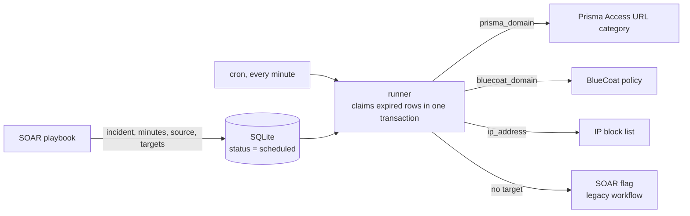

# Firewall Unban Scheduler

[](https://github.com/AtakanUk/firewall-unban-scheduler/actions/workflows/ci.yml)

[](LICENSE)

Time-limited blocking for SOAR playbooks. A playbook blocks an IP or domain and says *"lift this in 24 hours"*. The scheduler remembers that, and a runner removes the block on time from whichever enforcement point holds it. Block lists stay small, temporary blocks don't become permanent by accident, and every unban is traceable to the incident that caused the block.

## Enforcement points

| Target | How the unban is done |
| --- | --- |
| **IP block list** | Plain-text list published to the firewalls as an external dynamic list. Lines are removed with an atomic file replace, so a firewall never fetches a half-written file. |
| **Symantec / BlueCoat Edge SWG** | The policy's URL list is kept as JSON. The domain is removed and the whole content is pushed to the policy API. |
| **Prisma Access URL category** | OAuth client credentials → read the category → remove the domains → `PUT` it back. |
| **SOAR (legacy)** | When a row has no target, the incident fields `unban_action_control = Yes` and `scheduler_source` are set, and a SOAR workflow performs the unban. |

After a direct unban, the same SOAR fields are also set so dashboards can count unbans. If that update fails it is only logged, because the unban itself already succeeded.

## How it works



A successful unban marks the row `done`. A deleted SOAR incident also ends the row, because retrying could never succeed. Any other error schedules the row again 10 minutes later.

- **Upsert per (incident, source)**: scheduling again extends the ban, keeps targets that are not repeated, and re-opens finished rows.
- **No lost unbans**: failed rows go back to `scheduled` with a later expiry and the last error. A deleted SOAR incident (`Unable to find Incident`) ends the row instead of retrying forever.
- **One alert mail per run**: errors are buffered and sent together when the run ends.
- **Orphan purge**: `purge` lists active rows without any target and block-list IPs that no active row refers to. It is a dry run unless `--apply` is given, backs up the list before rewriting it, and refuses to apply more than `--max-changes` items.

## Usage

```bash
pip install -r requirements.txt
cp .env.example .env

python -m unban_scheduler schedule --incident-id 2101 --source ip-block --minutes 1440 --ip 198.51.100.7
python -m unban_scheduler schedule --incident-id 2102 --source proxy-block --minutes 60 --prisma-domain bad.example
python -m unban_scheduler list --status scheduled
python -m unban_scheduler run
python -m unban_scheduler purge                       # report only
python -m unban_scheduler purge --apply --max-changes 50
python -m unban_scheduler block-ip 198.51.100.7,198.51.100.8
```

Cron:

```cron
* * * * * cd /opt/unban-scheduler && .venv/bin/python firewall_unban_scheduler.py run >> logs/runner.log 2>&1
```

### SOAR functions

`soar_app/functions.py` contains two function components for an app generated with `resilient-sdk codegen`:

- `unban_scheduler`, with the inputs `incident_id`, `unban_minutes`, `unban_source` and the optional targets
- `ip_block_list`, which adds or removes IPs on the block list (`firewall_action` = `Add` / `Remove`)

Both use the same environment configuration as the CLI.

## Configuration

See `.env.example`. Only the backends that are configured are used. A row that needs a missing backend fails, gets retried and shows up in the error mail.

## Tests

```bash
pip install pytest
pytest
```

The tests cover the upsert and claim logic, block-list editing, dispatch priority, retry and the "incident deleted" handling, the BlueCoat push, and the purge safety limits.

## License

[MIT](LICENSE)
